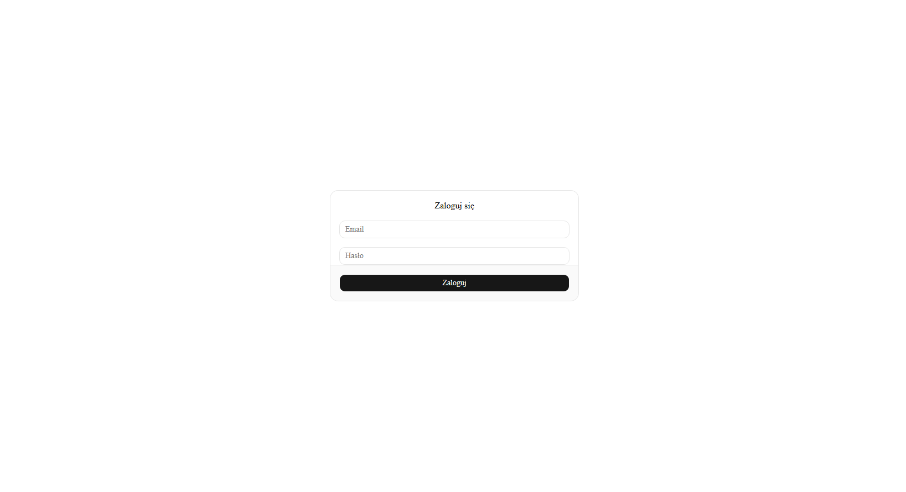
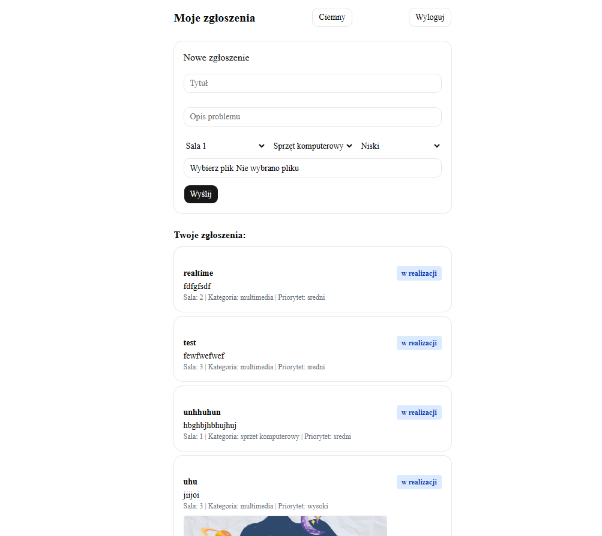
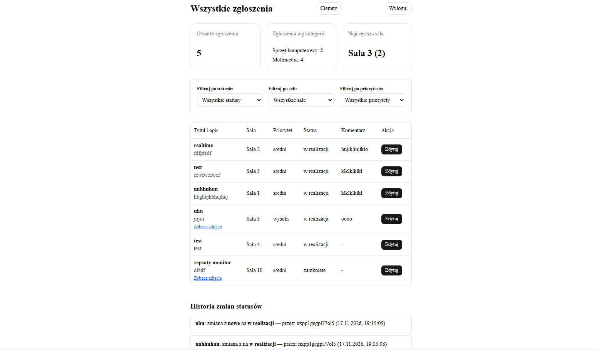

# Szkolny helpdesk

Prosta aplikacja do zgłaszania awarii w salach (komputery, rzutniki itp.) zrobiona w **Next.js** i podpięta pod bazę **PocketBase**.

---

## Zawartość aplikacji

- **Logowanie:** Dwa osobne widoki – zwykły użytkownik widzi tylko swoje zgłoszenia, a technik widzi wszystko.
- **Użytkownik (`/moje-zgloszenia`):**
  - Może dodać nowe zgłoszenie (tytuł, opis, sala, kategoria, priorytet i zdjęcie).
  - Formularz sprawdza, czy pola nie są puste (walidacja `zod` + `react-hook-form`).
  - Widzi listę swoich zgłoszeń, ich status i wrzucone zdjęcia.
- **Technik (`/technik`):**
  - **Statystyki na górze:** ile jest otwartych zgłoszeń, ile w jakiej kategorii i w której sali psuje się najwięcej rzeczy.
  - **Tabela zgłoszeń:** może filtrować po statusie, sali i priorytecie.
  - **Edycja:** zmienia status (nowe / w realizacji / zamkniete) i dopisuje komentarz.
  - **Na żywo (Realtime):** jak ktoś doda zgłoszenie, u technika od razu pojawia się na liście bez odświeżania strony.
  - **Historia zmian:** każda zmiana statusu zapisuje się na dole strony (kto zmienił, kiedy i z jakiego statusu na jaki).
- **Tryb ciemny i jasny:** Przycisk w rogu zmienia kolory strony.

---

## Wygląd aplikacji

### Logowanie

### Panel użytkownika

### Panel technika

---

- **Zwykły użytkownik:**
  - Email: `user@gmail.com`
  - Hasło: `testtest`

- **Technik:**
  - Email: `technik@gmail.com`
  - Hasło: `testtest`

## Coolify 
Strona stoi na serwerze vps na ktorym wdrozony jesy Coolify. W nim zainstalowane dwie uslugi:

    -**Pocketbase** na którym przechowywane są wszystkie dane ze strony
    -**Next js** pod główną subdomeną aplikacji. Wykorzystuje zmienną środowiskową `NEXT_PUBLIC_POCKETBASE_URL` wskazującą na subdomenę PocketBase
